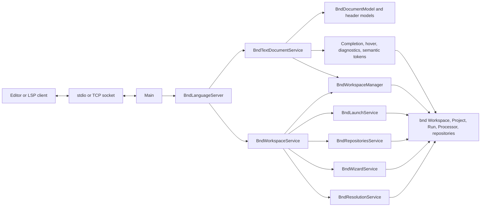
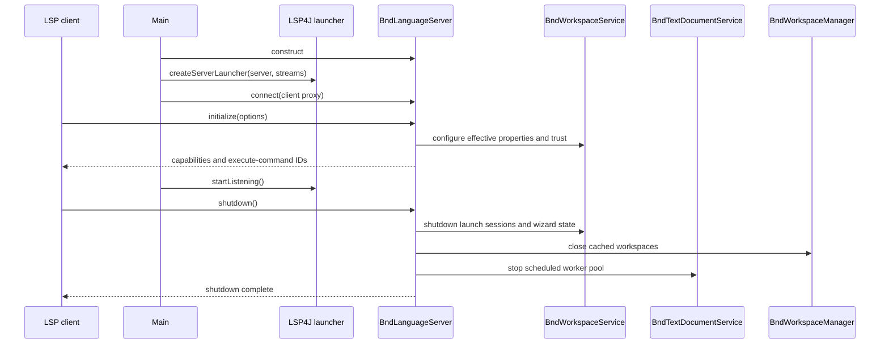
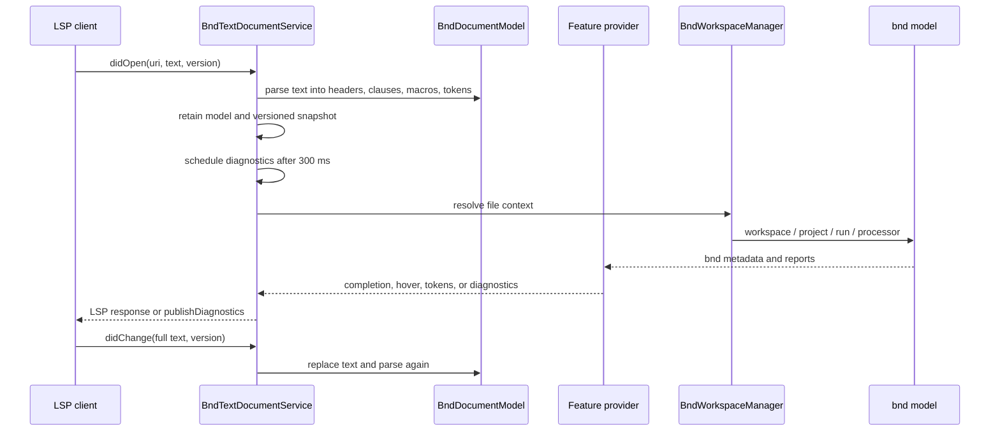
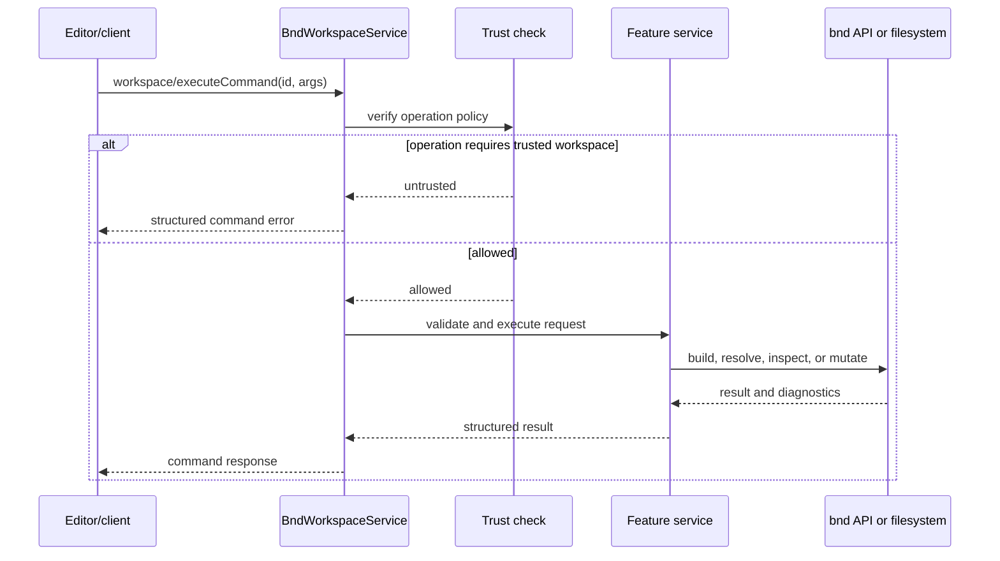

# bnd Language Server Architecture

This document describes the implementation in this project: its process boundary, LSP request routing, document model, workspace integration, state ownership, and extension workflow. It is intended for maintainers changing server behavior.

## Scope and Runtime

The server is a Java Language Server Protocol (LSP) process implemented with LSP4J. `Main` starts one server instance and selects one transport:

- By default, JSON-RPC messages use standard input and standard output. Logs go through SLF4J.
- With `--socket <port>`, the process listens on that port, accepts one socket connection, and uses that socket's input and output streams.

The process entry point and bundle packaging are configured in [bnd.bnd](bnd.bnd). `Main-Class` is `aQute.bnd.lsp.Main`; the bundle embeds the LSP4J, Gson, and bnd dependencies it needs.

## Component Map



`BndLanguageServer` is the LSP adapter and composition root. It advertises capabilities, connects the client proxy, creates the text-document and workspace services, and owns their shared scheduler and workspace manager. Feature logic is delegated to focused services rather than placed in the protocol entry point.

## Startup and Shutdown



The client initialization option `workspaceTrusted` is read during `initialize` and passed to the workspace service. Shutdown closes retained launch sessions, clears wizard plans/catalogs, closes cached bnd workspaces, and shuts down the scheduled worker pool. `exit` terminates the process.

## LSP Surface

The capabilities returned by `BndLanguageServer.initialize` currently include:

| Capability | Implementation |
| --- | --- |
| Full text synchronization | `BndTextDocumentService` |
| Completion | `BndCompletionProvider` |
| Hover | `BndHoverProvider` |
| Full semantic tokens | `BndSemanticTokensProvider` |
| Document symbols and folding ranges | `BndTextDocumentService`, from parsed headers and clauses |
| Definition | `BndTextDocumentService`, for supported `-include` and workspace `-buildpath` references |
| Code actions | `BndTextDocumentService`, including resolve action for `.bndrun` documents |
| Formatting | Not advertised; the method returns no edits |
| Execute commands | `BndWorkspaceService`, with IDs from `Constants` |

Completion trigger characters are `-`, `:`, `=`, `$`, `{`, `;`, and `,`. The server does not provide incremental document synchronization: it uses LSP full-sync mode.

## Document Model and Analysis

Each open URI has a `BndDocumentModel`. The model uses bnd's properties document support for line positions and extracts bnd header entries, multiline continuation values, clauses, macros, and tokens. The model is deliberately a lightweight editor-facing representation; bnd `Processor`, `Project`, and `Run` remain the source of truth for evaluated values and build diagnostics.



On `didOpen`, the service creates the model and stores a text/version snapshot. On `didChange`, it replaces the entire text, reparses, updates the snapshot, and schedules diagnostics. Diagnostics are debounced per URI for 300 ms; opening or saving also triggers them. On close, model and snapshot are removed and the client receives an empty diagnostics list.

Request behavior is split between model-only and bnd-backed features:

- The model supplies source ranges, header/clauses, macro references, and tokens used by symbols, folding, definitions, semantic highlighting, and context-sensitive completion.
- Completion combines syntax help and common macros with context-dependent workspace project, repository, bundle, and version data.
- Hover and diagnostics resolve a bnd processor from the file context. For project files, diagnostics build/analyze through a `ProjectBuilder`; `.bndrun` diagnostics evaluate run bundles.
- Effective properties evaluates a versioned editor snapshot when available, preserving unsaved text for the requested file while loading its surrounding workspace/properties context from disk. A mismatched requested document version returns a stale-document result.

## Workspace and State Ownership

`BndWorkspaceManager` is the boundary between file URIs and bnd workspace objects. It:

1. Converts file URIs and paths to `File` values.
2. Walks upward from the file to find `cnf/build.bnd`.
3. Lazily caches a `Workspace` for the directory containing that `cnf` directory.
4. Resolves projects by walking parent directories because bnd's `Workspace.getProjectFromFile` expects a project directory, not an arbitrary file.
5. Selects a `Run` for `.bndrun` files, otherwise a project or workspace `Processor` as context permits.

The manager owns cached workspace lifetimes. It closes cached workspaces when their `cnf/build.bnd` disappears, including their remote-workspace servers, and creates a fresh workspace if the configuration returns. Its workspace cache and lock map are concurrent maps. Workspace refresh and the `executeWithWorkspaceLock` helper use per-workspace locks; the helper runs submitted workspace tasks on a single daemon executor. This is not an implicit transaction around every service operation, so callers should use the lock helper when an operation requires serialized workspace access.

| State | Owner | Lifetime |
| --- | --- | --- |
| Open document models and editor snapshots | `BndTextDocumentService` | From `didOpen` until `didClose` |
| Pending diagnostic debounce tasks | `BndTextDocumentService` | Replaced on subsequent edit; cleared with scheduler shutdown |
| Workspace objects and workspace locks | `BndWorkspaceManager` | Workspaces close when their configuration disappears or at shutdown; locks remain until shutdown |
| Prepared external launchers | `BndLaunchService` | From prepare until explicit dispose or server shutdown |
| Template catalogs and preview plans | `BndWizardService` | Explicitly disposed, server shutdown, or 15-minute expiry |

## Workspace Commands

The client invokes commands through LSP `workspace/executeCommand`. `BndLanguageServer` advertises command IDs; `BndWorkspaceService` dispatches them and delegates feature-specific work:

| Command area | Owner | Responsibility |
| --- | --- | --- |
| Build project/workspace, resolve `.bndrun`, macro expansion, repository listing, JAR printing | `BndWorkspaceService` | Adapt command arguments to bnd build, resolve, macro, repository, and JAR APIs |
| Effective properties | `BndEffectivePropertiesService` | Evaluate raw/expanded/merged properties, provenance, diagnostics, and source text |
| Resolution analysis | `BndResolutionService` | Extract OSGi requirements/capabilities from selected `.bnd` or JAR inputs and mark local matches |
| Launch prepare/dispose | `BndLaunchService` | Prepare run or test launch configuration for the editor/debugger; retain resources until disposal |
| Repository browse and management | `BndRepositoriesService` | List repositories, bundles, versions, features, search, get/put, refresh, actions, download, and offline mode |
| Template wizard | `BndWizardService` | List workspace templates or fragments, create directly after confirmation, or use the legacy preview/apply flow; dispose retained state |

The command constants are centralized in [Constants.java](src/aQute/bnd/lsp/Constants.java). When adding a command, keep its constant, advertised ID, dispatch case, argument/result contract, and tests aligned. The dispatcher converts exceptions into an `{ "error": ... }` result for command callers; feature services may also return structured errors for expected outcomes.

Capability registration is not proof of a working handler: `BndLanguageServer` currently advertises `bnd.build.clean` and `bnd.baseline`, but `BndWorkspaceService.executeCommand` has no dispatch cases for these IDs. They reach the unknown-command fallback and return `null`.

## Trust and Side Effects

Trust is supplied by the client at initialization. The workspace service explicitly requires a trusted workspace for effective-properties evaluation, resolution analysis, launch preparation, and repository/wizard requests. The corresponding checks are at the command boundary, before delegation. Other command paths should be reviewed individually when changing trust behavior; do not assume all commands share one authorization check.

Operations that mutate or retain state have explicit lifecycle handling:

- Launch preparation may build dependencies, create a `ProjectLauncher` or `ProjectTester`, and retain it under a generated launch ID. The client must dispose it; shutdown disposes any remaining sessions.
- Repository operations can refresh remote/local indexes, download artifacts, put bundles, change offline mode, or run repository-provided actions.
- The current wizard client confirms sources and possible overwrites before direct creation. The service generates files in memory and internally prepares, applies, and disposes a plan without staging an entire workspace. The legacy preview/apply API remains available. Both paths validate destination paths, symlinks, source trust, dirty documents, file count and size limits, and changed files; application uses rollback-aware writes.
- Resolution of a run updates its resolved run bundles and refreshes the workspace after successful resolution.



## Extension Workflow

For a new LSP feature:

1. Add the protocol capability or command ID in `BndLanguageServer` and [Constants.java](src/aQute/bnd/lsp/Constants.java), as applicable.
2. Keep protocol adaptation in the matching LSP service. Put reusable document behavior in a provider/model and bnd operations in a focused service.
3. Resolve workspace/project context through `BndWorkspaceManager`; avoid creating independent long-lived `Workspace` instances unless the feature owns and closes them.
4. Define argument validation, response shape, trust requirements, and disposal behavior at the service boundary.
5. Add focused tests beside the owning service or model, plus a server-level test when capability advertisement or protocol routing changes.

## Build and Test

Run project tests and build the bundle from the repository root:

```bash
./gradlew :biz.aQute.bnd.lsp:test :biz.aQute.bnd.lsp:jar
```

Tests are under `test/aQute/bnd/lsp`. `BndLanguageServerTest` covers capability advertisement and command behavior; service and model tests cover focused behavior such as completion, hover, effective properties, repositories, launches, wizard planning, and document parsing.

## Source Map

| Area | Source |
| --- | --- |
| Process and LSP composition | [Main.java](src/aQute/bnd/lsp/Main.java), [BndLanguageServer.java](src/aQute/bnd/lsp/BndLanguageServer.java) |
| Command IDs | [Constants.java](src/aQute/bnd/lsp/Constants.java) |
| Document lifecycle and LSP methods | [BndTextDocumentService.java](src/aQute/bnd/lsp/services/BndTextDocumentService.java) |
| Header and token model | [BndDocumentModel.java](src/aQute/bnd/lsp/models/BndDocumentModel.java) |
| Workspace lookup, caching, and locking | [BndWorkspaceManager.java](src/aQute/bnd/lsp/services/BndWorkspaceManager.java) |
| Command dispatch | [BndWorkspaceService.java](src/aQute/bnd/lsp/services/BndWorkspaceService.java) |
| Main feature providers | `src/aQute/bnd/lsp/services/` |
| Server and provider tests | `test/aQute/bnd/lsp/` |