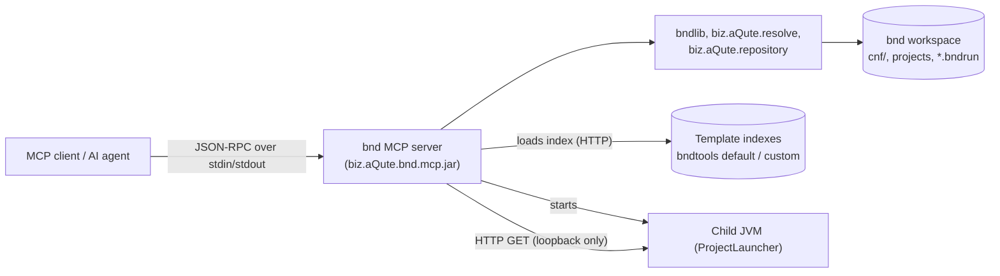
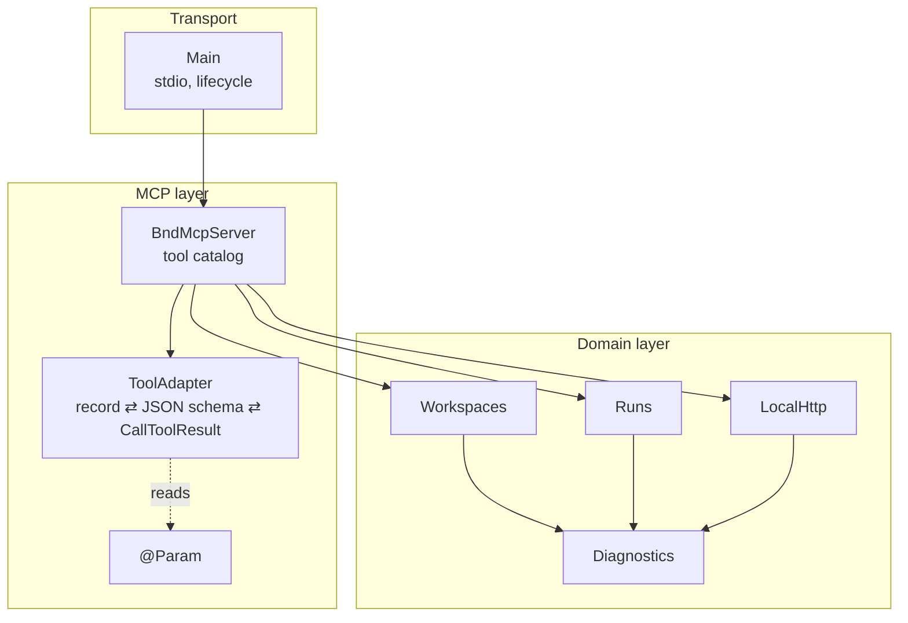
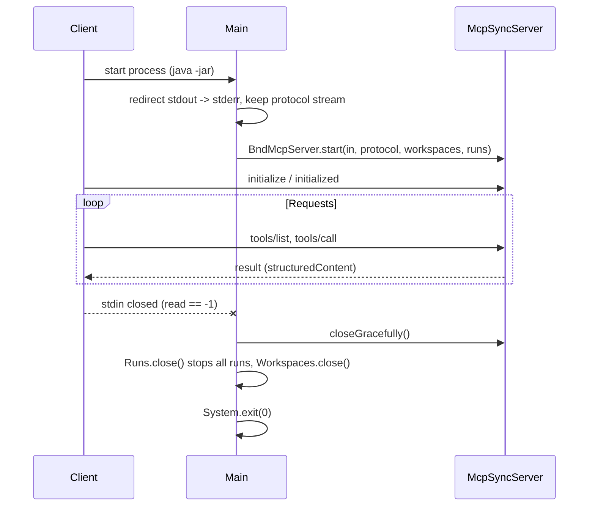

# bnd MCP Server Architecture

This document describes the goals, structure and design decisions of the `biz.aQute.bnd.mcp` module.
Implementation details are in [implementation.md](./implementation.md), the individual tools in [tools.md](./tools.md).

## 1. Goal

`biz.aQute.bnd.mcp` exposes bnd through the [Model Context Protocol (MCP)](https://modelcontextprotocol.io).
An AI agent (e.g. GitHub Copilot, Claude Desktop) can then, without shell knowledge of its own:

- create or extend bnd workspaces from template fragments,
- describe workspaces (projects, `.bndrun` files, repositories, errors),
- build projects and resolve `.bndrun` files,
- start, observe and stop `.bndrun` files in a child JVM,
- check a running service via HTTP on loopback (smoke test).

The module is a self-contained, executable bundle (`Main-Class: aQute.bnd.mcp.Main`) with embedded dependencies.
It communicates over **stdio** (JSON-RPC, one message per line).

## 2. Context

## 3. Layers

The server is deliberately split into three layers. **Only the adapter knows the MCP model**; the domain classes are plain Java over records.

| Layer | Classes | Responsibility |
|---|---|---|
| Transport | [`Main`](../src/aQute/bnd/mcp/Main.java) | protect stdout, detect end of stdin, create/close resources |
| MCP | [`BndMcpServer`](../src/aQute/bnd/mcp/BndMcpServer.java), [`ToolAdapter`](../src/aQute/bnd/mcp/ToolAdapter.java), [`Param`](../src/aQute/bnd/mcp/Param.java) | register tools, derive schema, bind arguments, map results |
| Domain | [`Workspaces`](../src/aQute/bnd/mcp/Workspaces.java), [`Runs`](../src/aQute/bnd/mcp/Runs.java), [`LocalHttp`](../src/aQute/bnd/mcp/LocalHttp.java), [`Diagnostics`](../src/aQute/bnd/mcp/Diagnostics.java) | bnd business logic behind simple `Spec → Result` methods |

## 4. Design decisions

### 4.1 Functions over records instead of MCP types

Every tool is a Java function `Spec → Result` over **records**.
The input record also provides the JSON schema (via `@Param`); the result record becomes `structuredContent`.
Benefits:

- Domain classes can be tested without the MCP SDK (`RunsTest`, `WorkspacesTest`).
- A new tool is one line in `BndMcpServer.tools(...)` plus a record.
- The SDK can be swapped without touching the business logic.

### 4.2 Diagnostics instead of exceptions

Business problems are **not thrown**; they are returned as `Diagnostics(errors, warnings)` inside the result.
A result record implementing `Diagnostics.Carrier` is automatically reported to the client as `isError=true` when it contains errors.
The agent therefore always receives a complete, evaluable result (e.g. also the console output of a failed start) rather than a protocol error object.

| Situation | Representation |
|---|---|
| Business error (not a workspace, build error, timeout) | tool result with `isError=true`, `structuredContent.diagnostics.errors` |
| Warning (index not readable, fragment requires unknown dependency) | `diagnostics.warnings`, `isError=false` |
| Missing required parameter / invalid argument | `isError=true`, text message, handler not called |
| Unexpected exception in handler | `isError=true`, `ClassName: message` |

### 4.3 Own input validation

For JSON schema validation the MCP SDK would need `networknt`, which is not embedded.
Therefore:

- `validateToolInputs(false)` and an `ACCEPT_ALL` validator in the SDK,
- type binding by Jackson (`convertValue` onto the record),
- required-parameter check in the `ToolAdapter` based on `@Param(required = true)`.

The schema is still delivered to the client in full (`additionalProperties: false`, `required`, descriptions).

### 4.4 Security model

The server executes workspace code (build, launch). It therefore limits what an agent can trigger:

| Measure | Where | Effect |
|---|---|---|
| `.bndrun` must really be inside the workspace, be a regular file and end in `.bndrun` | `Runs.runFile` | prevents path escape (also via symlinks, `toRealPath`) |
| Third-party fragments require `trustThirdParty=true` | `Workspaces.create` | fragments from other organisations can run code at build time |
| Existing non-empty files are never overwritten | `Workspaces.keepExistingFiles` | create is idempotent, user content wins |
| Conflicts between fragments are detected before writing | `Workspaces.create` | no half-written workspace |
| HTTP check only `http://` against loopback, no user info | `LocalHttp.get` | no SSRF into foreign networks |
| Child JVM HTTP port is a free port, readiness via `127.0.0.1` | `Runs.start` | no fixed, colliding ports |

> The server is intended for **local, trusted** use (one process per client over stdio). It offers no authentication.

### 4.5 State and concurrency

- `Workspaces`: all public methods are `synchronized`; a lazily created *scratch workspace* in a temporary directory is used to read the template indexes and is deleted in `close()`.
- `Runs`: running starts are `Session` objects in a `ConcurrentHashMap` (key: run ID). Each session owns a daemon thread executing `ProjectLauncher.launch()`.
- `build`/`resolve`: open their own `Workspace` per call (try-with-resources) and keep no state.
- MCP SDK: the synchronous server (`McpServer.sync`) invokes handlers synchronously per request.

## 5. Process lifecycle

Important: **stdout belongs to the protocol.** `Main` sets `System.out` to `System.err` so that output from bndlib cannot corrupt the JSON-RPC stream.

## 6. Dependencies and packaging

- MCP SDK `io.modelcontextprotocol.sdk:mcp-core` and `mcp-json-jackson2` (version in `bnd.bnd` as `mcp.version`), Jackson 2.21, Project Reactor, slf4j.
- bnd modules: `biz.aQute.bndlib`, `biz.aQute.bnd.util`, `biz.aQute.repository`, `biz.aQute.resolve`, `aQute.libg`.
- Everything is embedded into a single executable jar via `-includeresource` (`Private-Package: aQute.bnd.mcp`). Exception: `networknt` (see 4.3).
- Maven coordinates of the third-party libraries are in `cnf/ext/central.mvn`.
- Result: `biz.aQute.bnd.mcp/generated/biz.aQute.bnd.mcp.jar`.

## 7. Extensibility

Adding a new tool:

1. Create an input record with `@Param`-annotated components (allowed types: `String`, `boolean`, `int`/`long`, `List<…>`, `Map<String,…>`).
2. Create a result record; implement `Diagnostics.Carrier` if it reports errors.
3. Implement the business logic in a domain class as a method `Result f(Spec)`.
4. Register it in `BndMcpServer.tools(...)` with `.tool(name, description, Spec.class, handler)`.
5. Add a test (domain directly, optionally JSON-RPC in `BndMcpServerTest`).

Unsupported parameter types (e.g. nested records) raise an `IllegalArgumentException` at registration.

## 8. Limits

- Tools only; no MCP resources, prompts or sampling. `ServerCapabilities` declares `tools(listChanged=false)`.
- stdio transport only, no HTTP/SSE.
- Runs are bound to the server process; they are stopped when the client exits.
- The console output of a run is limited to the last 200 lines.
