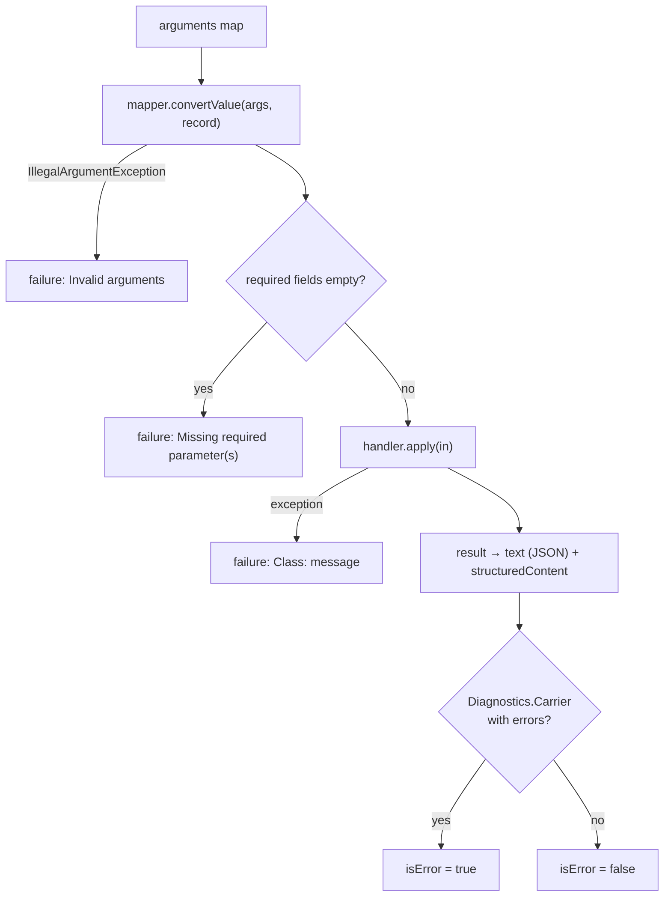
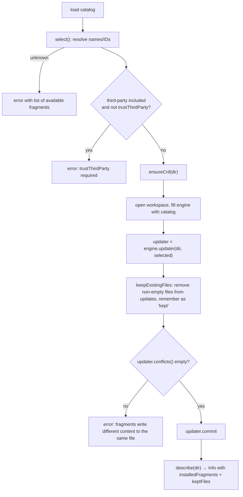
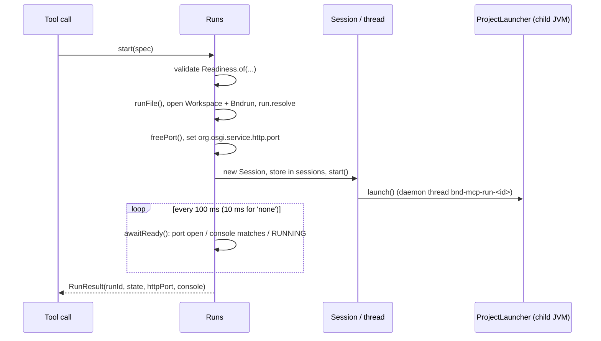
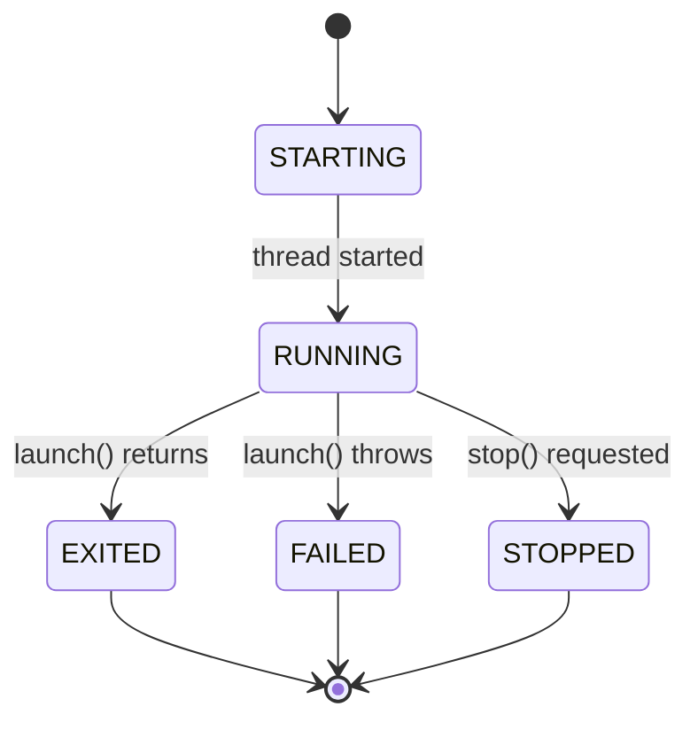

# bnd MCP Server Implementation

This document describes class by class how [architecture.md](./architecture.md) is implemented.
Sources: [`src/aQute/bnd/mcp`](../src/aQute/bnd/mcp), tests: [`test/aQute/bnd/mcp`](../test/aQute/bnd/mcp).

## 1. Overview

| File | Role |
|---|---|
| [`Main`](../src/aQute/bnd/mcp/Main.java) | entry point, stdio, shutdown |
| [`BndMcpServer`](../src/aQute/bnd/mcp/BndMcpServer.java) | tool catalog and server setup |
| [`ToolAdapter`](../src/aQute/bnd/mcp/ToolAdapter.java) | record ⇄ schema ⇄ `CallToolResult` |
| [`Param`](../src/aQute/bnd/mcp/Param.java) | annotation for schema description and required flag |
| [`Diagnostics`](../src/aQute/bnd/mcp/Diagnostics.java) | errors/warnings as a value |
| [`Workspaces`](../src/aQute/bnd/mcp/Workspaces.java) | fragments, create/describe workspace |
| [`Runs`](../src/aQute/bnd/mcp/Runs.java) | build, resolve, run start/stop/status |
| [`LocalHttp`](../src/aQute/bnd/mcp/LocalHttp.java) | loopback HTTP check |

## 2. `Main`

Flow of `main`:

1. `System.out` is saved as `protocol` and redirected to `System.err` (bndlib must not disturb the protocol stream).
2. `System.in` is wrapped in a `FilterInputStream`. As soon as `read(...)` returns `-1`, a `CountDownLatch` counts down → the client has disconnected.
3. `Workspaces` (with the default index `FragmentTemplateEngine.DEFAULT_INDEX`) and `Runs` are created in try-with-resources.
4. A shutdown hook calls `runs.close()` so that child JVMs are stopped even on a hard termination.
5. `BndMcpServer.start(...)` starts the server, `disconnected.await()` blocks, then `server.closeGracefully()` and `System.exit(0)`.

## 3. `BndMcpServer`

- `tools(Workspaces, Runs)` builds the `ToolAdapter` with all nine tools (name, description, input record, handler). See [tools.md](./tools.md).
- `start(InputStream, OutputStream, Workspaces, Runs)` creates the server:

```java
McpServer.sync(new StdioServerTransportProvider(jsonMapper, in, out))
    .serverInfo("bnd", version)             // version from Implementation-Version, else "dev"
    .jsonMapper(jsonMapper)
    .jsonSchemaValidator(ToolAdapter.ACCEPT_ALL)
    .validateToolInputs(false)
    .capabilities(ServerCapabilities.builder().tools(false).build())
    .tools(tools.tools())
    .build();
```

- Input records needed by several tools are defined here: `FragmentQuery` and `Location`. `FragmentQuery` normalizes `indexes` in its compact constructor (`null` → empty list, defensive copy).
- Streams are injected, so the test can run the server over `Pipe`s instead of real process streams.

## 4. `ToolAdapter`

### 4.1 Registration

`tool(name, description, Class<I> input, Function<I,?> handler)` creates a `Tool` definition with the derived schema and a `SyncToolSpecification` whose callback is `call(...)`.

### 4.2 Schema derivation (`schema`, `type`)

Each record component becomes a property. Type mapping:

| Java | JSON schema |
|---|---|
| `String` | `{"type":"string"}` |
| `boolean`, `Boolean` | `{"type":"boolean"}` |
| `int`, `Integer`, `long`, `Long` | `{"type":"integer"}` |
| `List<T>` | `{"type":"array","items":T}` |
| `Map<K,V>` | `{"type":"object","additionalProperties":V}` |
| anything else | `IllegalArgumentException("Unsupported tool parameter type …")` |

`@Param.value()` becomes `description`; `required=true` ends up in the `required` list. The root object always has `additionalProperties: false`.

### 4.3 Invocation (`call`)



- "Empty" applies to `null`, blank strings and empty lists (`isEmpty`).
- Missing inputs yield the defaults of the record components (`null`, `0`, `false`); handlers must treat `0`/`null` as "not set" themselves.
- The result is delivered twice: as JSON text (`content[0].text`) for clients without structured-content support, and as `structuredContent`.
- Exceptions are reduced to their cause with `Exceptions.unrollCause`.

## 5. `Diagnostics`

Immutable record `(List<String> errors, List<String> warnings)`.

- `none()`, `error(format, args…)`, `ok()` (no errors).
- `plus(...)` concatenates and **deduplicates** entries, preserving order.
- `Carrier` is the marker interface for results that have `diagnostics()`.

## 6. `Workspaces`

### 6.1 State

- `defaultIndexes`: list of template indexes that are always queried.
- `scratch`: lazily created temporary workspace (`Files.createTempDirectory("bnd-mcp-")` with a minimal `cnf/`), only used to read the fragment indexes. `close()` closes and deletes it.

### 6.2 Catalog (`catalog`)

1. A `FragmentTemplateEngine` on the scratch workspace.
2. Default indexes + indexes passed by the caller, deduplicated, each loaded via `engine.read(URL)`. Failure → **warning** ("Index … not readable"), no abort.
3. Additionally the fragments configured via `-workspace-templates`.
4. Result: `Catalog(engine, templates, diagnostics)`.

### 6.3 `fragments(indexes, includeArchived)`

Filters archived fragments (unless `includeArchived`) and maps `TemplateInfo` to `Fragment(name, id, description, official, archived, requires)`. The `id` (`idOf`) is `organisation/repository[/path][#ref]`, with `master` omitted as ref.

### 6.4 `create(Spec)`



Properties:

- Fragment files are **only written** if all fragments are known, trust is given and there are no conflicts (conflicts are checked before `commit()`). The minimal `cnf/` is, however, created beforehand.
- `select` resolves requirements via `engine.resolveRequirements(selected)`. A requirement that is in no index is reported as a warning.
- `ensureCnf` creates `cnf/ext`, an empty `cnf/build.bnd` and `cnf/bnd.bnd` with `-nobundles: true` if missing. An **empty** file does not count as user content for `keepExistingFiles`, so a fragment may fill it.
- The method is idempotent: a second call extends but overwrites nothing.
- Without selected fragments only the minimal `cnf/` is ensured.

### 6.5 `describe(dir)`

- Checks `cnf/build.bnd`; otherwise error "Not a bnd workspace".
- Opens the workspace, lists all projects (without `cnf`), `*.bndrun` per project directory (relative to the workspace root, with `/`), repository names (without `WorkspaceRepository`) and `getErrors()`/`getWarnings()` as diagnostics.
- Initializing the repositories may download indexes.

## 7. `Runs`

### 7.1 `build(BuildSpec)`

Opens a `Workspace`, fetches `workspace.getProject(name)`, calls `project.build()` and returns the absolute paths of the produced files plus `project.getErrors()/getWarnings()`. Unknown project → error "Unknown project". Any exception becomes "Build failed".

### 7.2 `resolve(ResolveSpec)`

`runFile(...)` validates the file (see 7.6), then `Bndrun.createBndrun(workspace, file)` and `run.resolve(false, writeChanges)`. Returns: path, resolved `-runbundles` string, diagnostics of the run.

### 7.3 `start(StartSpec)` – flow



Details:

- **Readiness** is validated *before* any resource is created (`Readiness.of`): `http` (default), `console` (needs `readyPattern`, Java regex, `find()` per line) or `none` (state `RUNNING`). Invalid → `FAILED` without resources.
- The HTTP port is determined via `ServerSocket(0)` and set as run property `org.osgi.service.http.port`. It is returned as `httpPort` in the result.
- stdout/stderr of the child JVM and launcher notifications go into a `RingBuffer`.
- Timeout (`startupTimeoutMillis`, default 30000 ms):
  - Thread still alive → the run is stopped, result `FAILED`, error "did not become ready".
  - Thread already ended → error "exited before becoming ready" with state and exit code.
- On exceptions during setup, launcher, run and workspace are closed (no leak); after handover to the session the local references are set to `null` so the `catch` does not close anything twice.
- If the manager is closed (`closed`), `STOPPED` with an error is returned immediately.

### 7.4 Session states



The run thread sets `RUNNING`, calls `launcher.launch()` (the exit code is stored) and closes the launcher in `finally`. If `stopping` was set, the final state is `STOPPED` instead of `EXITED`/`FAILED`. In addition, `status` returns state `UNKNOWN` for unknown IDs.

### 7.5 `stop`, `status`, `close`

- `stop`: unknown ID → idempotent `STOPPED` without error. Thread no longer active → release resources. Otherwise `stopping=true`, `launcher.cancel()`, `join(5000)`; if the thread is still alive afterwards → error "did not stop within 5000 ms".
- `status`: snapshot of the session (state, port, exit code, console). A stored `failure` is reported as an error; unknown ID → error and `UNKNOWN`.
- `close`: once only (CAS on `closed`), stops all sessions.
- `Session.release()` closes `Bndrun` and `Workspace` exactly once (`AtomicBoolean released`).

### 7.6 Path check (`runFile`)

```text
path (relative → resolved against workspace root)
  → toRealPath()                       // follows symlinks, file must exist
  → must start with the real workspace root
  → must be a regular file
  → file name ends with ".bndrun"
otherwise IllegalArgumentException("Not a workspace .bndrun file: …")
```

### 7.7 `RingBuffer`

Implements `Appendable` as target for `launcher.setStreams(...)`.

- Splits incoming characters into lines at `\n`, ignores `\r` and empty lines.
- Keeps at most 200 lines (`CONSOLE_LINES`); older ones are dropped.
- Checks each completed line against `readyPattern` and remembers the first match (`matched`). Detection therefore also works when a line arrives fragmented over several `append` calls (tested).
- `snapshot()` also contains a last, not yet completed line.
- Access is `synchronized`, `matched` is `volatile`.

## 8. `LocalHttp`

`get(GetSpec)`:

1. Parse the URL; only scheme `http`, host `localhost` or an IP address for which `isLoopbackAddress()` holds (IPv4/IPv6, brackets are removed), and no user info are allowed. Other host names are rejected before DNS is consulted.
2. Defaults: timeout 5000 ms, expected status 200.
3. Repeats GET (pause 100 ms, connect timeout `min(timeout, 2000)`) until status **and** (if set) body substring match, or the total time has elapsed.
4. Result: `url`, last `status`, `body`, `attempts`, diagnostics (the timeout error contains the last failure cause). Interrupt → error "HTTP check interrupted", and the interrupt flag stays set.

## 9. Tests

| Test | Verifies |
|---|---|
| `BndMcpServerTest` | end-to-end via JSON-RPC over `Pipe`: tool list and schema, create workspace with structured content, errors as `isError` instead of protocol errors |
| `WorkspacesTest` | fragment catalog, create, kept files, trust, conflicts (with index fixtures) |
| `RunsTest` | path guard outside the workspace, idempotent stop/status of unknown ID, readiness validation, `RingBuffer` across chunk boundaries |
| `LocalHttpTest` | successful check against a local `HttpServer`, rejection of non-loopback URLs |

Run:

```bash
./gradlew :biz.aQute.bnd.mcp:test
./gradlew :biz.aQute.bnd.mcp:jar
```

## 10. Known quirks

- Missing numeric parameters arrive as `0`; `0` means "use default" everywhere.
- `build` and `resolve` block the call until finished; there is no cancel tool.
- `describe` and `create` are serialized (`synchronized`) so the scratch workspace is not used in parallel.
