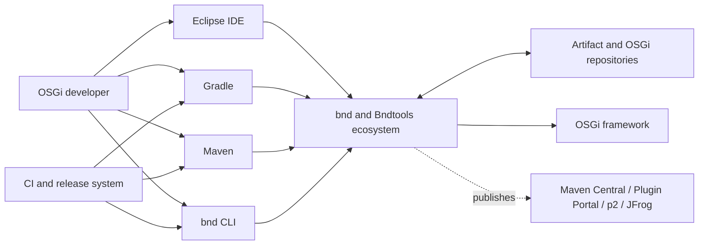
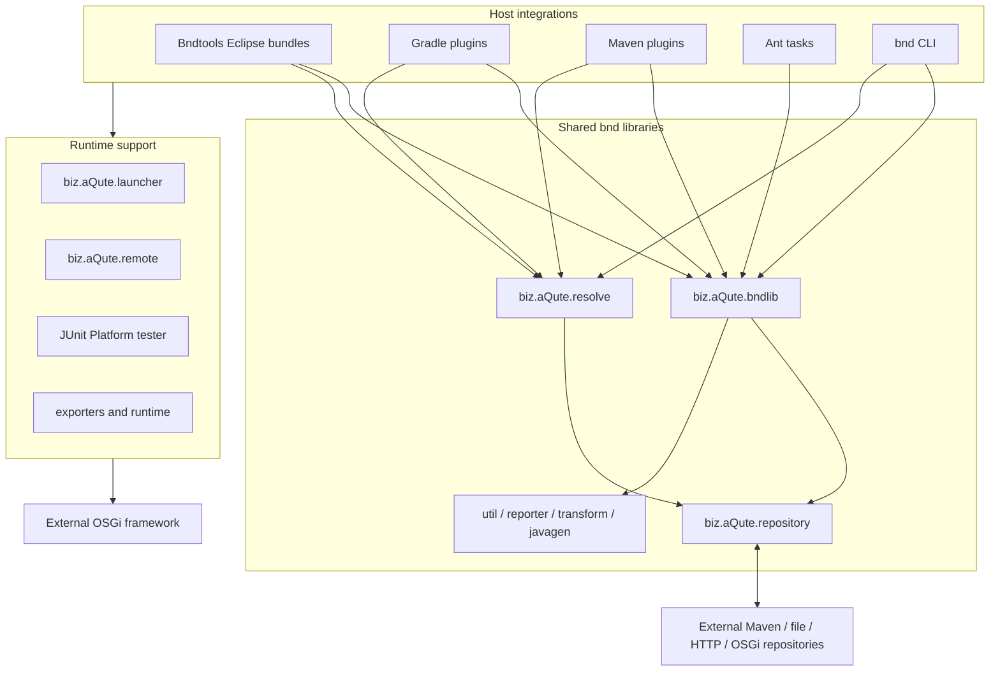

# 3. System Scope and Context

## 3.1 Business context

### Inputs

- compiled classes, source files, resources, and dependencies;
- bnd instructions and macros;
- workspace/project definitions;
- Maven and Gradle project models;
- Eclipse workspace resources and user actions;
- OSGi repository indexes and artifact repositories;
- launch, resolve, test, and export descriptions.

### Outputs

- OSGi bundles and generated manifests;
- repository indexes and resolved run-bundle lists;
- executable JARs and other exported distributions;
- API baseline reports and versioning diagnostics;
- generated source/resources and reports;
- launched OSGi frameworks and test reports;
- Eclipse markers, editors, launch configurations, and repository views.

## 3.2 Technical context

## 3.3 External interfaces

| Interface | Direction | Protocol or format |
|---|---|---|
| Java API | Inbound | bndlib and companion library APIs |
| bnd configuration | Inbound | `.bnd`, `bnd.bnd`, macros, properties |
| Run configuration | Inbound/outbound | `.bndrun`, including resolved `-runbundles` |
| Bundle artifacts | Inbound/outbound | JAR and OSGi manifest |
| OSGi repositories | Inbound/outbound | OSGi Repository XML and indexed resources |
| Maven repositories | Inbound/outbound | Maven coordinates, metadata, HTTP(S) |
| Gradle | Inbound | Plugin API, tasks, configurations, providers |
| Maven | Inbound | Plugin goals, reactor/lifecycle, project model |
| Eclipse | Inbound/outbound | Extension registry, OSGi services, resources, markers, launch and debug APIs |
| Runtime control | Outbound | Local process launch or remote-agent communication |
| Publication | Outbound | Maven Central/JFrog, Gradle Plugin Portal, Eclipse p2 |

## 3.4 GitHub organization boundary

The active architectural center is
[bndtools/bnd](https://github.com/bndtools/bnd). Relevant supporting
repositories include:

| Repository | Role |
|---|---|
| [bndtools.github.io](https://github.com/bndtools/bndtools.github.io) | Bndtools website, built from Markdown with Jekyll/GitHub Pages |
| [bndtools.p2.repo](https://github.com/bndtools/bndtools.p2.repo) | Eclipse p2 release and Oomph setup repository |
| [workspace](https://github.com/bndtools/workspace) | Starter bnd workspace using Gradle |
| [workspace-templates](https://github.com/bndtools/workspace-templates) | Reusable workspace template fragments and release definitions |
| [bndtools.workspace.min](https://github.com/bndtools/bndtools.workspace.min) | Minimal Maven-repository-based bnd workspace |
| [project-templates](https://github.com/bndtools/project-templates) | Sources for Bndtools project templates |
| [jpmcli](https://github.com/bndtools/jpmcli) | Separate Java package manager CLI historically used to install bnd/JPM programs |

Archived repositories such as
[bndtools](https://github.com/bndtools/bndtools),
[bnd.manual](https://github.com/bndtools/bnd.manual), and
[bndtools-rt](https://github.com/bndtools/bndtools-rt) document consolidation
into the main repository or earlier generations. They are historical context,
not current system-of-record components.

[Back to index]({{ '/development/architecture/' | relative_url }})

