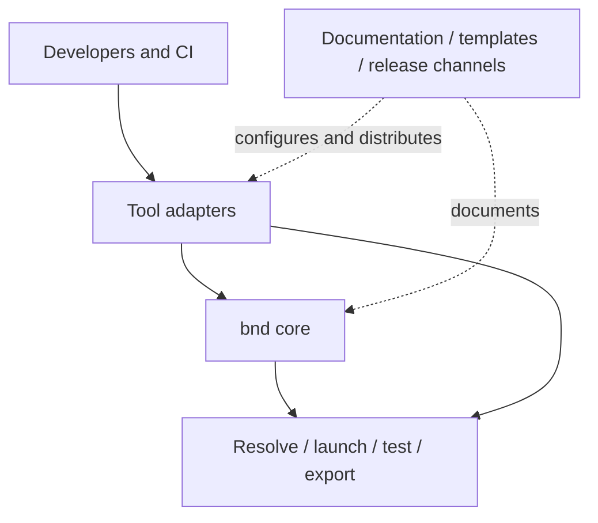
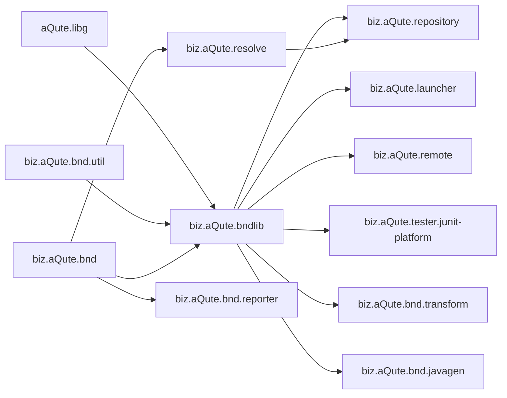
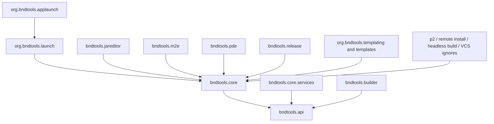

# 5. Building Block View

## 5.1 Level 1: ecosystem

| Block | Responsibility |
|---|---|
| Tool adapters | Present bnd through Eclipse, CLI, Gradle, Maven, and Ant |
| bnd core | Analyze classes, process instructions, build/verify JARs, and model workspaces/projects |
| Operations | Access repositories, resolve requirements, launch frameworks, run tests, export distributions, and report |
| Delivery | Publish artifacts and Eclipse features; provide websites, examples, and templates |

## 5.2 Level 2: core and runtime modules

### Core modules

| Module | Responsibility |
|---|---|
| `aQute.libg` | Low-level general utilities shared by bnd modules |
| `biz.aQute.bnd.util` | Additional reusable utility APIs |
| `biz.aQute.bndlib` | Analyzer, builder, JAR/manifest model, instructions/macros, workspace/project model, plugins, API diff/baseline foundation |
| `biz.aQute.repository` | Repository implementations and Maven/OSGi repository access |
| `biz.aQute.resolve` | OSGi requirement resolution and run model integration |
| `biz.aQute.bnd` | Command-line facade over workspace and library functions |

### Specialized modules

| Module family | Responsibility |
|---|---|
| `biz.aQute.launcher`, `biz.aQute.remote` | Local and remote framework launch/control |
| `biz.aQute.tester.junit-platform` | In-framework JUnit Platform discovery and execution |
| `biz.aQute.tester` | Legacy tester, deprecated for removal in 8.0.0 |
| `biz.aQute.bnd.exporters`, `biz.aQute.bnd.runtime` | Export formats and runtime packaging |
| `biz.aQute.bnd.reporter` | Structured report generation/export |
| `biz.aQute.bnd.transform` | Class-file and manifest-header transformations |
| `biz.aQute.bnd.javagen` | Source/resource generation integration |
| `biz.aQute.bnd.maven` | Shared implementation used by Maven plugins |
| `biz.aQute.bnd.ant` | Ant task adapter |
| `biz.aQute.launchpad` | OSGi-oriented integration test support |

## 5.3 Level 2: Bndtools Eclipse bundles

| Bundle group | Responsibility |
|---|---|
| `bndtools.api` | Public Bndtools APIs and extension contracts |
| `bndtools.core` | Main Eclipse UI, editors, workspace integration, repositories, resolve/run UI |
| `bndtools.core.services` | Eclipse/OSGi service implementations used by core UI |
| `bndtools.builder` | Eclipse incremental/project builder integration and problem markers |
| `org.bndtools.launch`, `org.bndtools.applaunch` | Eclipse launch and application launch integration |
| `bndtools.jareditor` | JAR/bundle inspection editors |
| `bndtools.m2e` | Maven/Eclipse integration |
| `bndtools.pde` | PDE interoperability |
| `bndtools.release` | Release workflow integration |
| `org.bndtools.templating*`, `org.bndtools.templates*` | Template discovery and project/workspace creation |
| Headless, p2, remote-install, VCS-ignore bundles | Installation, automation, remote deployment, and project hygiene support |

Bndtools is intentionally a thin presentation and integration layer. Build
diagnostics should originate in bnd where practical; Bndtools maps detailed
locations to Eclipse markers through extension handlers.

## 5.4 Level 2: Gradle plugins

One artifact, `biz.aQute.bnd.gradle`, defines three plugin IDs:

| Plugin | Use |
|---|---|
| `biz.aQute.bnd.builder` | Adds bnd bundle building and baseline behavior to ordinary Gradle Java projects |
| `biz.aQute.bnd.workspace` | Discovers/configures a bnd workspace and applies project integration |
| `biz.aQute.bnd` | Implements tasks for individual projects in a bnd workspace; normally applied by the workspace plugin |

Reusable task types include `Bundle`, `Baseline`, `Resolve`, `Export`,
`TestOSGi`, `Index`, and `Bndrun`. Workspace mode additionally wires project
dependencies, build, release, resolve, run, export, and OSGi test tasks from the
bnd workspace model.

## 5.5 Level 2: Maven plugins

| Plugin | Responsibility |
|---|---|
| `bnd-maven-plugin` | Generate bundle manifest and metadata during Maven builds |
| `bnd-indexer-maven-plugin` | Generate OSGi repository indexes from Maven dependencies |
| `bnd-baseline-maven-plugin` | Check bundle/package semantic versions against a prior release |
| `bnd-resolver-maven-plugin` | Resolve `.bndrun` files |
| `bnd-export-maven-plugin` | Export `.bndrun` applications |
| `bnd-testing-maven-plugin` | Run integration tests described by `.bndrun` files |
| `bnd-run-maven-plugin` | Run a `.bndrun` file |
| `bnd-reporter-maven-plugin` | Generate and export project reports |
| `bnd-generate-maven-plugin` | Generate sources and resources |
| `bnd-plugin-parent` | Common plugin build and dependency configuration |

## 5.6 Supporting repositories

Supporting repositories contain delivery/configuration assets, not competing
core implementations:

- websites turn Markdown into published documentation;
- p2 repository metadata provisions Bndtools into Eclipse;
- workspace and project templates bootstrap consumer repositories;
- archived repositories preserve history after source consolidation.

[Back to index]({{ '/development/architecture/' | relative_url }})

