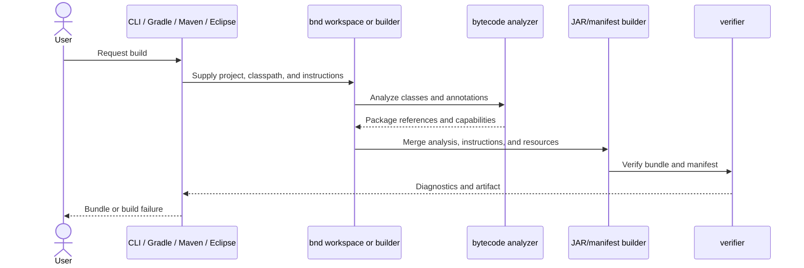
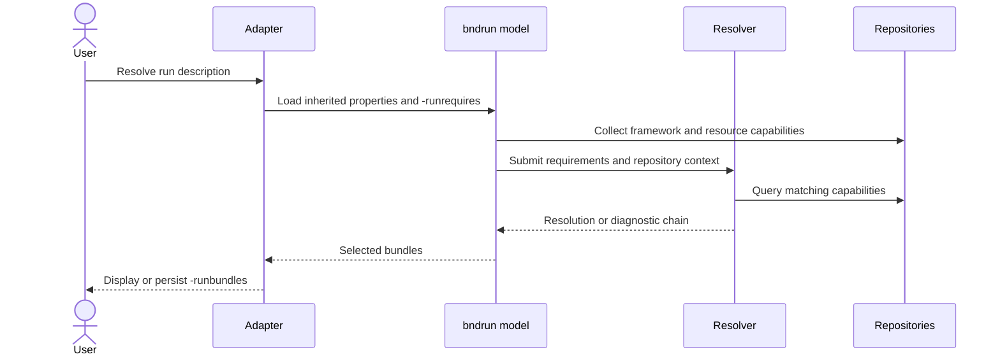
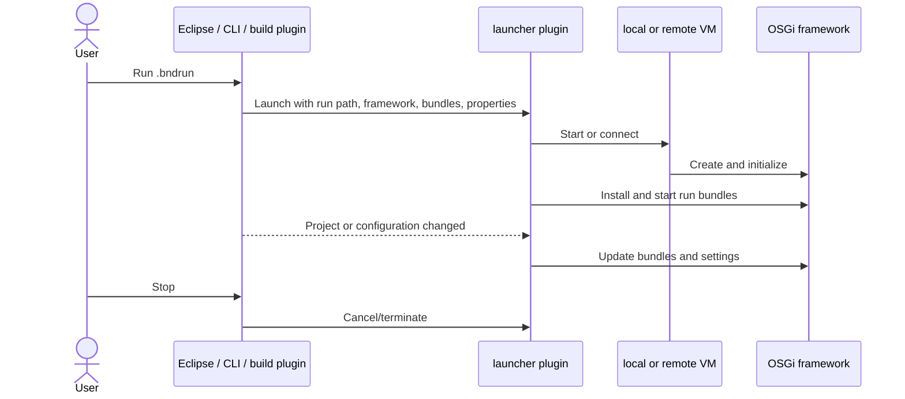
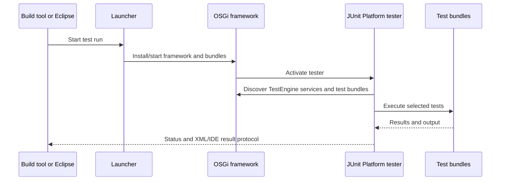

# 6. Runtime View

## 6.1 Build a bundle

Key behavior:

- ordered instructions select private/exported content;
- missing package references become candidate imports;
- macros and host properties are evaluated through a processor hierarchy;
- verification occurs before successful publication;
- Eclipse converts diagnostics into resource markers; headless hosts report
  them through native logging/failure mechanisms.

## 6.2 Resolve a `.bndrun`

Resolution separates desired capabilities (`-runrequires`) from selected,
versioned artifacts (`-runbundles`). Writing the result back creates a
reviewable and reproducible runtime definition.

## 6.3 Launch and synchronize

The default launcher starts a local VM. A remote launcher can connect to a
remote agent. Launcher selection is pluggable through a `Launcher-Plugin`
header on the run path.

## 6.4 OSGi test execution

The preferred tester is `biz.aQute.tester.junit-platform`. The legacy
`biz.aQute.tester` remains for compatibility but is deprecated.

## 6.5 Eclipse incremental build

1. Eclipse reports resource changes to the Bndtools builder.
2. Bndtools maps the Eclipse project to the bnd workspace/project model.
3. bnd computes affected outputs and diagnostics.
4. Generated bundles and model state are refreshed.
5. Diagnostic locations are converted into Eclipse markers.
6. Active launch sessions can receive updated bundles.

## 6.6 Baseline comparison

1. Adapter builds the current bundle.
2. Repository lookup obtains the configured previous bundle.
3. bnd compares exported APIs and relevant implementation changes.
4. Delta severity is mapped to required package and bundle version changes.
5. The host reports violations and versioning advice.

[Back to index]({{ '/development/architecture/' | relative_url }})

