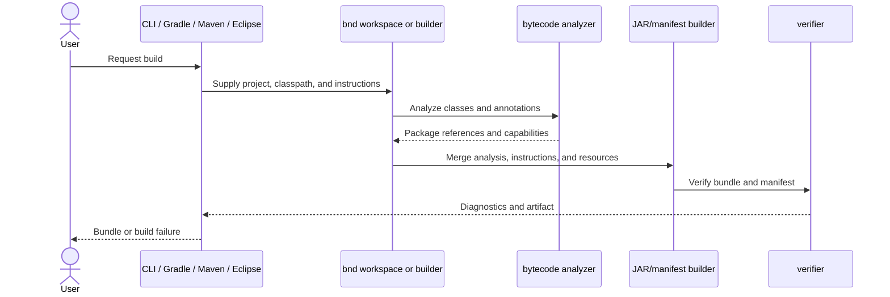
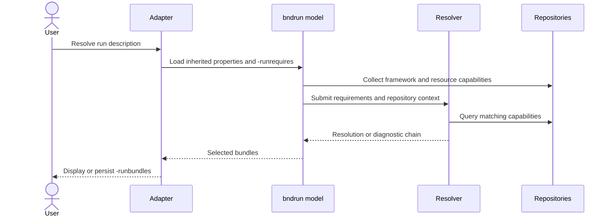
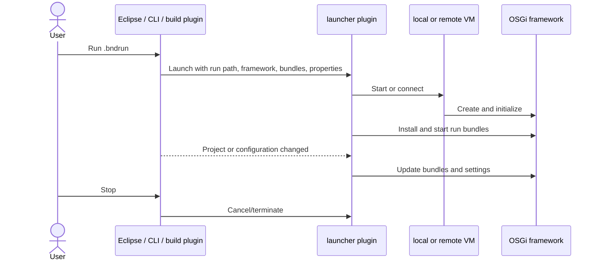
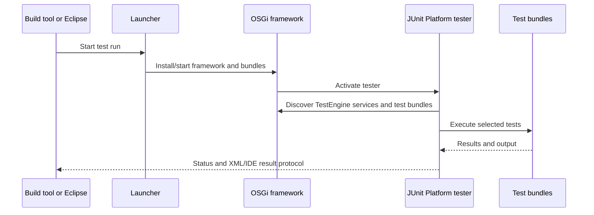

# 6. Runtime View

## 6.1 Build a bundle

Key behavior:

- ordered instructions select private/exported content;
- missing package references become candidate imports;
- macros and host properties are evaluated through a processor hierarchy;
- verification occurs before successful publication;
- Eclipse converts diagnostics into resource markers; headless hosts report
  them through native logging/failure mechanisms.

## 6.2 Resolve a `.bndrun`

Resolution separates desired capabilities (`-runrequires`) from selected,
versioned artifacts (`-runbundles`). Writing the result back creates a
reviewable and reproducible runtime definition.

## 6.3 Launch and synchronize

The default launcher starts a local VM. A remote launcher can connect to a
remote agent. Launcher selection is pluggable through a `Launcher-Plugin`
header on the run path.

## 6.4 OSGi test execution

The preferred tester is `biz.aQute.tester.junit-platform`. The legacy
`biz.aQute.tester` remains for compatibility but is deprecated.

## 6.5 Eclipse incremental build

1. Eclipse reports resource changes to the Bndtools builder.
2. Bndtools maps the Eclipse project to the bnd workspace/project model.
3. bnd computes affected outputs and diagnostics.
4. Generated bundles and model state are refreshed.
5. Diagnostic locations are converted into Eclipse markers.
6. Active launch sessions can receive updated bundles.

## 6.6 Baseline comparison

1. Adapter builds the current bundle.
2. Repository lookup obtains the configured previous bundle.
3. bnd compares exported APIs and relevant implementation changes.
4. Delta severity is mapped to required package and bundle version changes.
5. The host reports violations and versioning advice.

## 6.7 Pending LSP and MCP workflows

These workflows describe `fea-bnd-ls` and `fea-mcp`, not master:

- The editor sends LSP requests for editing features and `bnd.*` execute commands
  for workspace operations. Diagnostics are published back to the editor.
- `bnd.resolve` can write `-runbundles` or return a dry-run result with
  `writeChanges=false`; server support does not imply a client dry-run control.
- `bnd.launch.prepare` returns a launch configuration for run or OSGi test mode.
  The client starts/debugs the JVM and later calls `bnd.launch.dispose` to release
  the retained server-side launch session.
- MCP agents invoke `bnd_build` per project and `bnd_resolve` with an explicit
  write-back choice. MCP does not expose OSGi test execution.
- `bnd_run_start` creates a managed child JVM identified by `runId`;
  `bnd_run_status` reports its state/output, and `bnd_run_stop` stops it.
  Server shutdown cleans up managed sessions.
- The MCP working tree adds readiness selection (`http`, `console` with
  `readyPattern`, or `none`). This is **uncommitted behavior**, not a released
  readiness contract. `bnd_http_get` supports loopback HTTP smoke checks.

Exact inventories and reviewed revisions are in the
[Tooling Feature Matrix]({{ '/development/feature-matrix.html' | relative_url }}).

[Back to index]({{ '/development/architecture/' | relative_url }})
