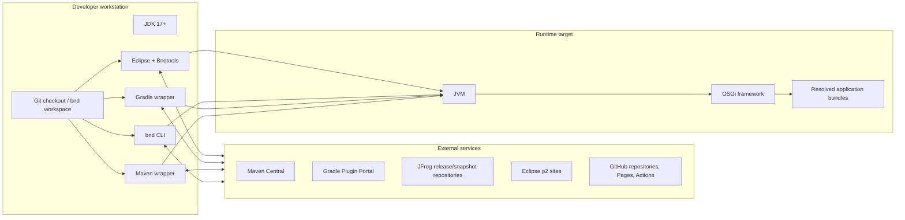
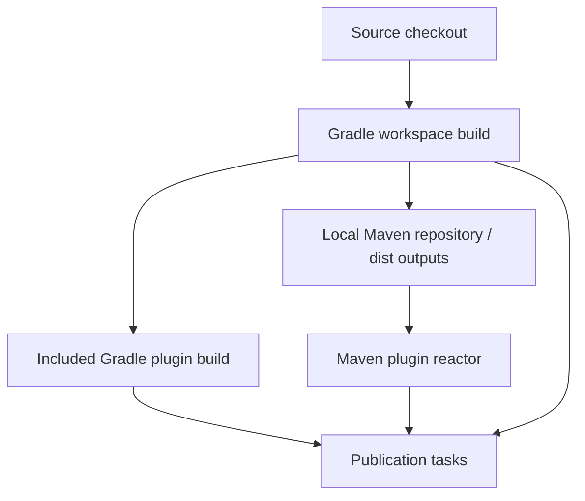

# 7. Deployment View

## 7.1 Development and build nodes

## 7.2 Published units

| Unit | Channel | Consumer |
|---|---|---|
| bnd Java libraries and CLI | Maven Central and JFrog | Applications, adapters, CLI users |
| Gradle plugin artifact and marker plugins | Gradle Plugin Portal/Maven repositories | Gradle builds |
| Maven plugins | Maven Central/JFrog plugin repositories | Maven builds |
| Bndtools Eclipse features/bundles | p2 update sites | Eclipse installations |
| Snapshot and release-candidate artifacts | JFrog | Early adopters and CI |
| Documentation | bnd site and GitHub Pages Bndtools site | Users and contributors |
| Workspace/project templates | GitHub/template repositories and Bndtools | New projects/workspaces |

## 7.3 Main repository build deployment

Core workspace artifacts must exist before Maven plugins can compile and test.
Release workflows then publish library/plugin artifacts and assemble Eclipse
update-site content.

## 7.4 Runtime deployment variants

| Variant | Description |
|---|---|
| Local development launch | Launcher creates a child JVM, starts an OSGi framework, installs run bundles, and synchronizes changes |
| Remote launch | Remote launcher/agent deploys and updates bundles in another JVM or host |
| Executable export | `.bndrun` is exported into an executable JAR or another supported distribution |
| Repository distribution | Bundles are published with Maven metadata and/or an OSGi repository index |
| Eclipse installation | p2 installs Bndtools features and bundles into Eclipse |

## 7.5 Operational assumptions

- Artifact repositories and update sites are external dependencies.
- Local caches improve performance but must not replace explicit repository
  configuration.
- Credentials for publication belong in CI/user settings, never source.
- Launch storage and generated build directories are disposable.
- `.bndrun` files and resolved bundle lists are source-controlled when
  reproducibility is required.

[Back to index]({{ '/development/architecture/' | relative_url }})

