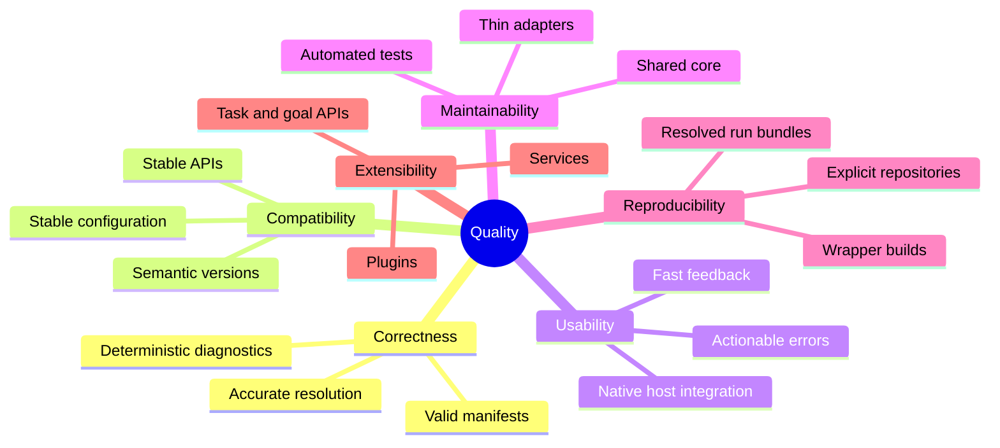

# 10. Quality Requirements

## 10.1 Quality tree

## 10.2 Quality scenarios

| ID | Scenario | Expected response |
|---|---|---|
| Q-1 | Developer adds a referenced package to compiled code | Next build derives corresponding import or reports why it cannot |
| Q-2 | Exported API receives an incompatible change without major version increment | Baseline task/goal fails with package and bundle version advice |
| Q-3 | Same bnd instructions are built in Eclipse and headless Gradle | Bundle metadata and content are semantically equivalent |
| Q-4 | `.bndrun` requirement has no provider | Resolver reports unresolved requirement chain and does not write misleading successful state |
| Q-5 | Source changes during an active Bndtools launch | Affected bundle rebuilds and launcher updates runtime without full manual restart where supported |
| Q-6 | Build runs without network after dependencies are cached | Explicit local/workspace repositories permit repeatable operation |
| Q-7 | Third party embeds bndlib | No Eclipse, Maven, or Gradle runtime is required |
| Q-8 | Maintainer adds a repository implementation | It integrates through repository/plugin contracts without changing analyzer logic |
| Q-9 | Gradle user applies builder plugin to an ordinary Java project | Existing `jar` workflow produces a verified OSGi bundle and baseline task is available |
| Q-10 | Maven user binds bnd plugin to package lifecycle | Manifest generation participates in Maven lifecycle and failures use Maven diagnostics |
| Q-11 | Eclipse error contains structured source detail | Bndtools places marker on relevant file/range rather than only `bnd.bnd` |
| Q-12 | Public package changes | Build detects required semantic version update before release |

## 10.3 Measurable acceptance indicators

- Targeted and module test suites pass for changed components.
- Full Gradle workspace build and affected plugin builds pass before release.
- Public API changes satisfy baseline checks.
- No adapter-specific implementation duplicates core bundle analysis.
- Resolve failures retain actionable requirement diagnostics.
- Generated artifacts are byte-for-byte stable where timestamps/signatures do
  not intentionally vary, or semantically equivalent otherwise.
- Documentation names minimum Java/build-tool versions and current deprecations.

[Back to index]({{ '/development/architecture/' | relative_url }})

